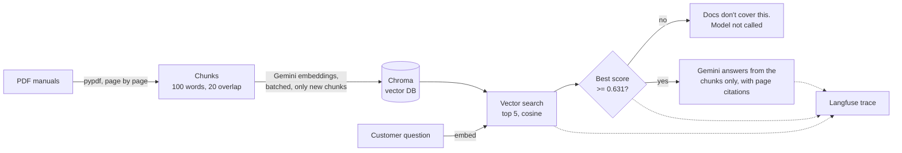

# Support RAG Assistant

[](https://github.com/TejpalSandhu/support-rag-assistant/actions/workflows/ci.yml)

A customer-support assistant that answers questions about product manuals
using Retrieval-Augmented Generation (RAG). It's built for the parts of support
bots that matter in production: **measuring retrieval quality, tuning it with
data, refusing questions the docs don't cover, and tracing every answer.**

The knowledge base is the official user manuals of two 3D printers, the
Original Prusa MINI+ and the Prusa XL (113 pages). Two similar products make
it a realistic test: both manuals explain "loading filament", but the steps
differ.

## Results at a glance

| | |
|---|---|
| Right page in the top 5 results | **100%** of 28 test questions |
| Right page ranked first | **86%** (MRR 0.91) |
| Context sent to the model after tuning | **12 -> 5 chunks** (~58% less), same hit rate |
| Questions the manuals don't cover that were refused | **8 of 8**: 5 by the score threshold (no model call), 3 by the model |
| Hallucinated answers in the end-to-end check | **0** |

Full numbers and decisions are in [experiments.md](experiments.md).

## How it works



1. **Ingest:** each PDF page is split into overlapping 100-word chunks. A chunk
   never spans two pages, so every answer can cite a page.
2. **Embed and store:** chunks are embedded with `gemini-embedding-001` in
   batches and stored in a persistent Chroma collection. Each chunk ID includes
   a hash of its text, so re-runs embed only new or changed chunks. A crash
   mid-build loses nothing, because every batch is saved right away.
3. **Retrieve:** the question is embedded and Chroma returns the 5 nearest
   chunks. `verify_chroma.py` checks that Chroma's ranking matches a
   hand-written cosine similarity over all chunks.
4. **Two refusal layers:**
   - If even the best match scores below `MIN_SCORE`, the bot says the
     manuals don't cover it and skips the model call.
   - Otherwise the prompt tells the model to answer only from the retrieved
     text and to say when it doesn't have enough information.
5. **Trace:** every question becomes a Langfuse trace with the retrieved
   chunks, the relevance check, the prompt, the answer, token usage and the
   time each step took.

## Evaluation

`eval_questions.json` holds 28 customer-style questions, each with the file
and page that answers it, plus 8 questions the manuals can't answer (5 near
misses such as "How much does the XL cost?", and 3 off-topic).

`evaluate.py` measures **hit@k** (is the right page in the top k?) and **MRR**
(how high is the first right result?) for several chunk settings:

| chunk size | overlap | chunks | hit@1 | hit@3 | hit@5 | MRR |
|---:|---:|---:|---:|---:|---:|---:|
| 100 | 0 | 358 | 79% | 89% | 100% | 0.87 |
| **100** | **20** | **409** | **86%** | **93%** | **100%** | **0.91** |
| 100 | 50 | 557 | 82% | 93% | 93% | 0.88 |
| 200 | 40 | 219 | 86% | 93% | 100% | 0.90 |
| 300 | 60 | 159 | 79% | 96% | 100% | 0.87 |

- **Overlap helps, up to a point.** 0 -> 20 words moved 3 questions to rank 1.
  At 50, near-duplicate chunks crowd the top 5.
- **hit@5 = 100%**, so `TOP_K` went from 12 to 5: less noise and a shorter prompt.
- **Main failure mode is product confusion.** The XL's nearly identical
  nozzle-cleaning page outranks the MINI's for a MINI question.

`choose_threshold.py` picks `MIN_SCORE` from the best-match scores of all 36
questions. Near-miss questions can score **higher** than real ones (0.73 vs
0.65), so a threshold alone can't stop them. That's why the prompt is the
second layer. Details are in [experiments.md](experiments.md).

## Tracing with Langfuse

With Langfuse keys in `.env`, each question shows up as a trace:

```
support-question                 question in, final answer out
├── embed-question   (embedding)  model, time taken
├── vector-search    (retriever)  the 5 chunks with source, page and score
├── relevance-check  (guardrail)  best score vs MIN_SCORE -> covered or not
└── answer           (generation) full prompt, answer, token usage
```

All questions from one run share a session ID, and the terminal prints a
direct link to each trace. Without keys the assistant runs the same way and
tracing is simply off.

## Run it

Requirements: Python 3.12 and a free [Gemini API key](https://aistudio.google.com/apikey).

```bash
python -m venv .venv
.venv\Scripts\activate          # macOS/Linux: source .venv/bin/activate
pip install -r requirements.txt
copy .env.example .env          # macOS/Linux: cp .env.example .env, then add your keys
```

Download the manuals into `pdfs/` (they're not redistributed in this repo):

```bash
mkdir pdfs
curl -L -o pdfs/prusa3d_manual_mini_en.pdf https://www.prusa3d.com/downloads/manual/prusa3d_manual_mini_en.pdf
curl -L -o pdfs/prusa3d_manual_xl_en.pdf https://www.prusa3d.com/downloads/manual/prusa3d_manual_xl_en.pdf
```

| Command | What it does |
|---|---|
| `python rag_assistant.py` | Builds the index on the first run, then answers questions in a loop |
| `python evaluate.py` | Retrieval evaluation across chunk settings -> `eval_results.md` |
| `python choose_threshold.py` | Recommends `MIN_SCORE` -> `threshold_results.md` |
| `python verify_chroma.py` | Compares Chroma's ranking with brute-force cosine similarity |
| `uvicorn api:app --reload` | Starts the web API; try it at http://127.0.0.1:8000/docs |
| `pytest` | Runs the automated tests (needs `pip install -r requirements-dev.txt`) |

### Website (React)

With the API running (`uvicorn api:app --reload`), start the website in a
second terminal (needs [Node.js](https://nodejs.org) 20+):

```bash
cd frontend
npm install
npm run dev        # open http://localhost:5173
```

Upload PDFs on the left, ask questions on the right. Answers show which
passages they came from, and questions the documents don't cover are clearly
marked instead of guessed. Each answer has 👍/👎 buttons, and the **Metrics**
page shows how many questions were answered, refused or failed, response
times and the 👍 rate (read live from Langfuse; needs Langfuse keys). `npm test` runs the website's tests and
`npm run lint` checks the code.

### Docker (website + API with one command)

With [Docker Desktop](https://www.docker.com/products/docker-desktop/) running:

```bash
docker compose up --build      # open http://localhost:8080
docker compose down            # stop
```

Two containers start: `backend` (FastAPI, Python 3.12) and `frontend` (the
built React site served by nginx, which forwards `/api` to the backend).
Settings come from `.env`; your `pdfs/` and `chroma_db/` folders are mounted
into the backend, so nothing is embedded twice. Set up Google sign-in (below)
before putting it anywhere public.

### Live on Azure (automatic deploy)

Every push to `main` that passes the tests is deployed to **Azure Container
Apps**. The CI workflow builds one image (API plus the built website), pushes
it to GitHub Container Registry, and points the container app at it. GitHub
logs in to Azure with OIDC, so no Azure password is stored anywhere.

- **One container, scales to zero:** it only runs (and costs) while in use;
  the first visit after a quiet spell takes a little longer while it starts.
- **Storage:** Chroma lives on the container's own disk. After a PDF is
  indexed, its chunks and vectors are backed up as JSON to Azure Blob Storage,
  and a fresh container rebuilds the index from those backups at startup,
  without calling Gemini again.
- **Secrets** (Gemini, Langfuse, the session secret) are Azure secrets, copied
  from `.env` by `deploy/set-azure-secrets.ps1`.
- **Threshold for any PDF:** `MIN_SCORE` was tuned to 0.631 on the two
  manuals, but broad questions about other PDFs score lower (a real question
  about a 2-page job description scored 0.599 and was wrongly refused). The
  live site uses `MIN_SCORE=0.55`; the evaluation showed every answerable
  question still passes and the prompt refuses the off-topic ones that get
  through, while clearly unrelated questions (0.46-0.52) never reach the model.

### Sign in with Google

Only people on an email allowlist can use the site:

1. The website shows Google's sign-in button; Google gives the browser a
   signed ID token for the chosen account.
2. The backend checks Google's signature, that the token is for this app,
   and that the email is in `ALLOWED_EMAILS`.
3. It then sets a signed, HttpOnly, SameSite session cookie for 7 days.
   Removing an email from the list locks that person out on their next request.

**Everyone has their own documents.** Every chunk is stored with its owner's
email, and listing, searching and deleting only ever see the signed-in
person's chunks, so two people can each have a `manual.pdf`. Uploaded files
and backups live under a short hash of the email (`<owner code>/manual.pdf.json`),
so addresses don't appear in paths. The first email in `ALLOWED_EMAILS` is the
owner, who receives anything uploaded before accounts existed. The website
uses its own Chroma collection, separate from the manuals used by the CLI and
the evaluation scripts.

Each person gets `DAILY_QUESTION_LIMIT` questions a day (default 20), so one
user can't use up the shared free Gemini quota. The live site runs with
`REQUIRE_LOGIN=true`: if the Google settings are ever missing, it refuses to
start rather than run open to everyone. Without `GOOGLE_CLIENT_ID` (local
development) login is off.

### Web API

| Endpoint | What it does |
|---|---|
| `GET /api/health` | Is the server up? (no login needed) |
| `POST /api/auth/google` | Sign in with a Google ID token; sets the session cookie |
| `POST /api/auth/logout` | Sign out |
| `GET /api/me` | Who is signed in, and questions left today |
| `GET /api/documents` | Uploaded PDFs with chunk counts and status |
| `POST /api/documents` | Upload a PDF; it's indexed in the background |
| `DELETE /api/documents/{name}` | Remove a PDF and its chunks |
| `POST /api/ask` | `{"question": "..."}` -> answer, sources, score, trace link |
| `POST /api/feedback` | `{"trace_id": "...", "helpful": true}`: a 👍/👎 saved as a Langfuse score |
| `GET /api/metrics?days=7` | Questions, answered/refused/failed, response time, 👍 rate |

With sign-in on, every endpoint except health and `/api/auth/...` needs the
session cookie. The tests use a fake Gemini client and a fake Google check, so
they are free, fast, and never touch your API quota.

On the Gemini free tier, every embedded text counts toward a limit of
roughly 100 per minute and 1,000 per day, and answers are limited to about
20 per day per model. If the answer model is busy, over its limit or too slow,
the app asks `FALLBACK_MODEL` (default `gemini-flash-lite-latest`) instead,
which has its own daily limit. The code waits out per-minute limits
using Google's own retry delay, stops cleanly when the daily limit is
reached, and resumes where it left off on the next run.

## Project structure

```
rag_assistant.py       the assistant: ingest, embed, store, retrieve, refuse, answer, trace
api.py                 web API (FastAPI) around rag_assistant.py
auth.py                sign in with Google, email allowlist, session cookie
metrics.py             numbers for the metrics page, from Langfuse's Metrics API
tests/                 automated API tests with a fake Gemini client (pytest)
frontend/              React website: upload PDFs, chat with sources (Vite, Vitest)
Dockerfile             backend image; frontend/Dockerfile builds the site into nginx
docker-compose.yml     runs both containers together
.github/workflows/     CI/CD: tests, lint, Docker builds; deploys main to Azure
deploy/                script that copies the keys from .env into Azure secrets
evaluate.py            retrieval evaluation (hit@k, MRR) across chunk settings
choose_threshold.py    picks the "docs don't cover this" threshold
verify_chroma.py       checks Chroma's ranking against hand-written cosine similarity
eval_questions.json    28 answerable + 8 unanswerable test questions with expected pages
eval_results.md        latest evaluation table
threshold_results.md   latest threshold table
experiments.md         experiment log: every change with before/after numbers
```

## Limitations and next steps

- **Page-level evaluation is too generous.** A question counts as found if
  any chunk from the right page is retrieved, even if it's not the chunk
  with the answer (seen with "How do I take the filament out of my MINI+?").
  Next: chunk-level labels, or judging the final answers.
- **Fixed-size chunks can split a section** or merge two topics. Next:
  chunk by the manual's headings.
- **Product confusion** between the MINI and the XL. Next: filter by product
  when the question names one, or add the product name to every chunk.
- **Vocabulary mismatch** ("take out" vs "unload"). Next: hybrid keyword +
  vector search.
- **Small eval set:** 28 questions, so one question is about 3.6 points.

## What I learned

- **Measure before tuning.** The default settings were already the best
  chunking option. The real win, cutting `TOP_K` from 12 to 5, only became
  visible once retrieval was measured.
- **Read the failures, not just the score.** The misses revealed product
  confusion and the page-level evaluation gap, which a single percentage hides.
- **Saying "I don't know" takes two layers.** A similarity threshold stops
  off-topic questions cheaply. Near-miss questions score like real ones and
  need the prompt-level rule.
- **Read error messages and quotas carefully.** The free tier counts every
  embedded text, not every batch request. Retries now follow the server's own
  retry delay, and work is saved batch by batch, so a quota error loses nothing.
- **Check the data first.** One candidate manual lost all its spaces in PDF
  extraction, which would have broken chunking. Looking at the extracted text
  caught it before it became a mystery "retrieval problem".

## Tech stack

Python 3.12 · Google Gemini (`google-genai`: embeddings and generation) ·
Chroma (vector database) · Langfuse (tracing) · pypdf ·
FastAPI · React (Vite) · Docker · GitHub Actions · Azure Container Apps and Blob Storage
