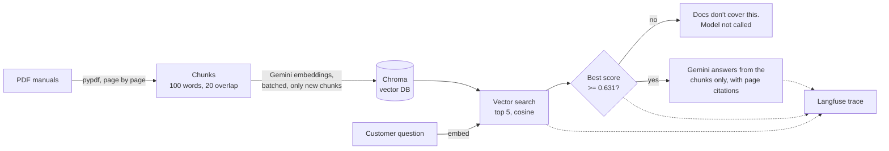

# Support RAG Assistant

A customer-support assistant that answers questions about product manuals
using Retrieval-Augmented Generation (RAG). It's built for the parts of support
bots that matter in production: **measuring retrieval quality, tuning it with
data, refusing questions the docs don't cover, and tracing every answer.**

The knowledge base is the official user manuals of two 3D printers, the
Original Prusa MINI+ and the Prusa XL (113 pages). Two similar products make
it a realistic test: both manuals explain "loading filament", but the steps
differ.

## Results at a glance

| | |
|---|---|
| Right page in the top 5 results | **100%** of 28 test questions |
| Right page ranked first | **86%** (MRR 0.91) |
| Context sent to the model after tuning | **12 -> 5 chunks** (~58% less), same hit rate |
| Questions the manuals don't cover that were refused | **8 of 8**: 5 by the score threshold (no model call), 3 by the model |
| Hallucinated answers in the end-to-end check | **0** |

Full numbers and decisions are in [experiments.md](experiments.md).

## How it works



1. **Ingest:** each PDF page is split into overlapping 100-word chunks. A chunk
   never spans two pages, so every answer can cite a page.
2. **Embed and store:** chunks are embedded with `gemini-embedding-001` in
   batches and stored in a persistent Chroma collection. Each chunk ID includes
   a hash of its text, so re-runs embed only new or changed chunks. A crash
   mid-build loses nothing, because every batch is saved right away.
3. **Retrieve:** the question is embedded and Chroma returns the 5 nearest
   chunks. `verify_chroma.py` checks that Chroma's ranking matches a
   hand-written cosine similarity over all chunks.
4. **Two refusal layers:**
   - If even the best match scores below `MIN_SCORE`, the bot says the
     manuals don't cover it and skips the model call.
   - Otherwise the prompt tells the model to answer only from the retrieved
     text and to say when it doesn't have enough information.
5. **Trace:** every question becomes a Langfuse trace with the retrieved
   chunks, the relevance check, the prompt, the answer, token usage and the
   time each step took.

## Evaluation

`eval_questions.json` holds 28 customer-style questions, each with the file
and page that answers it, plus 8 questions the manuals can't answer (5 near
misses such as "How much does the XL cost?", and 3 off-topic).

`evaluate.py` measures **hit@k** (is the right page in the top k?) and **MRR**
(how high is the first right result?) for several chunk settings:

| chunk size | overlap | chunks | hit@1 | hit@3 | hit@5 | MRR |
|---:|---:|---:|---:|---:|---:|---:|
| 100 | 0 | 358 | 79% | 89% | 100% | 0.87 |
| **100** | **20** | **409** | **86%** | **93%** | **100%** | **0.91** |
| 100 | 50 | 557 | 82% | 93% | 93% | 0.88 |
| 200 | 40 | 219 | 86% | 93% | 100% | 0.90 |
| 300 | 60 | 159 | 79% | 96% | 100% | 0.87 |

- **Overlap helps, up to a point.** 0 -> 20 words moved 3 questions to rank 1.
  At 50, near-duplicate chunks crowd the top 5.
- **hit@5 = 100%**, so `TOP_K` went from 12 to 5: less noise and a shorter prompt.
- **Main failure mode is product confusion.** The XL's nearly identical
  nozzle-cleaning page outranks the MINI's for a MINI question.

`choose_threshold.py` picks `MIN_SCORE` from the best-match scores of all 36
questions. Near-miss questions can score **higher** than real ones (0.73 vs
0.65), so a threshold alone can't stop them. That's why the prompt is the
second layer. Details are in [experiments.md](experiments.md).

## Tracing with Langfuse

With Langfuse keys in `.env`, each question shows up as a trace:

```
support-question                 question in, final answer out
├── embed-question   (embedding)  model, time taken
├── vector-search    (retriever)  the 5 chunks with source, page and score
├── relevance-check  (guardrail)  best score vs MIN_SCORE -> covered or not
└── answer           (generation) full prompt, answer, token usage
```

All questions from one run share a session ID, and the terminal prints a
direct link to each trace. Without keys the assistant runs the same way and
tracing is simply off.

## Run it

Requirements: Python 3.12 and a free [Gemini API key](https://aistudio.google.com/apikey).

```bash
python -m venv .venv
.venv\Scripts\activate          # macOS/Linux: source .venv/bin/activate
pip install -r requirements.txt
copy .env.example .env          # macOS/Linux: cp .env.example .env, then add your keys
```

Download the manuals into `pdfs/` (they're not redistributed in this repo):

```bash
mkdir pdfs
curl -L -o pdfs/prusa3d_manual_mini_en.pdf https://www.prusa3d.com/downloads/manual/prusa3d_manual_mini_en.pdf
curl -L -o pdfs/prusa3d_manual_xl_en.pdf https://www.prusa3d.com/downloads/manual/prusa3d_manual_xl_en.pdf
```

| Command | What it does |
|---|---|
| `python rag_assistant.py` | Builds the index on the first run, then answers questions in a loop |
| `python evaluate.py` | Retrieval evaluation across chunk settings -> `eval_results.md` |
| `python choose_threshold.py` | Recommends `MIN_SCORE` -> `threshold_results.md` |
| `python verify_chroma.py` | Compares Chroma's ranking with brute-force cosine similarity |

On the Gemini free tier, every embedded text counts toward a limit of
roughly 100 per minute and 1,000 per day. The code waits out per-minute limits
using Google's own retry delay, stops cleanly when the daily limit is
reached, and resumes where it left off on the next run.

## Project structure

```
rag_assistant.py       the assistant: ingest, embed, store, retrieve, refuse, answer, trace
evaluate.py            retrieval evaluation (hit@k, MRR) across chunk settings
choose_threshold.py    picks the "docs don't cover this" threshold
verify_chroma.py       checks Chroma's ranking against hand-written cosine similarity
eval_questions.json    28 answerable + 8 unanswerable test questions with expected pages
eval_results.md        latest evaluation table
threshold_results.md   latest threshold table
experiments.md         experiment log: every change with before/after numbers
```

## Limitations and next steps

- **Page-level evaluation is too generous.** A question counts as found if
  any chunk from the right page is retrieved, even if it's not the chunk
  with the answer (seen with "How do I take the filament out of my MINI+?").
  Next: chunk-level labels, or judging the final answers.
- **Fixed-size chunks can split a section** or merge two topics. Next:
  chunk by the manual's headings.
- **Product confusion** between the MINI and the XL. Next: filter by product
  when the question names one, or add the product name to every chunk.
- **Vocabulary mismatch** ("take out" vs "unload"). Next: hybrid keyword +
  vector search.
- **Small eval set:** 28 questions, so one question is about 3.6 points.

## What I learned

- **Measure before tuning.** The default settings were already the best
  chunking option. The real win, cutting `TOP_K` from 12 to 5, only became
  visible once retrieval was measured.
- **Read the failures, not just the score.** The misses revealed product
  confusion and the page-level evaluation gap, which a single percentage hides.
- **Saying "I don't know" takes two layers.** A similarity threshold stops
  off-topic questions cheaply. Near-miss questions score like real ones and
  need the prompt-level rule.
- **Read error messages and quotas carefully.** The free tier counts every
  embedded text, not every batch request. Retries now follow the server's own
  retry delay, and work is saved batch by batch, so a quota error loses nothing.
- **Check the data first.** One candidate manual lost all its spaces in PDF
  extraction, which would have broken chunking. Looking at the extracted text
  caught it before it became a mystery "retrieval problem".

## Tech stack

Python 3.12 · Google Gemini (`google-genai`: embeddings and generation) ·
Chroma (vector database) · Langfuse (tracing) · pypdf
